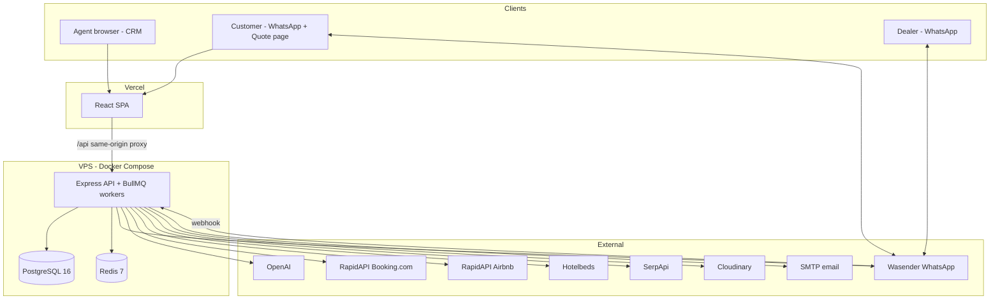
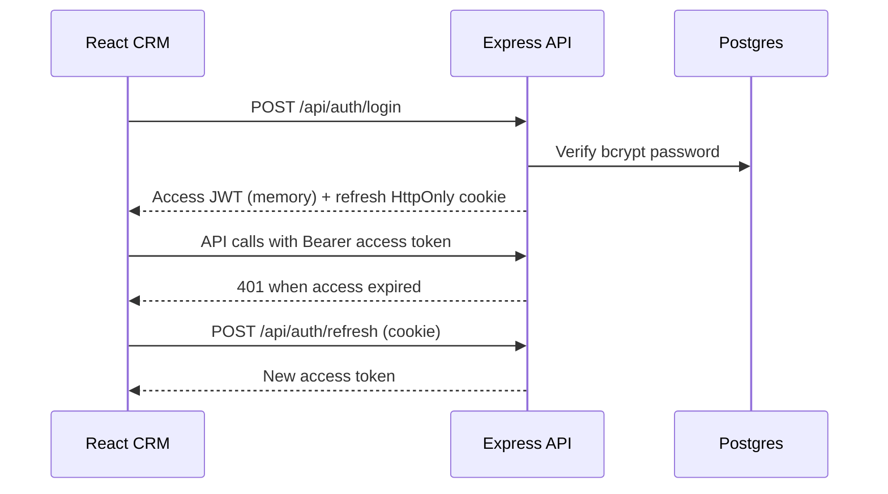
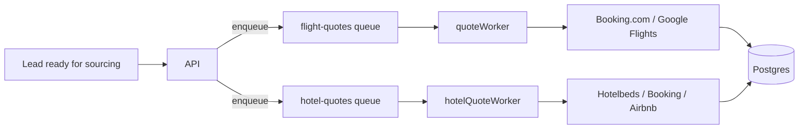
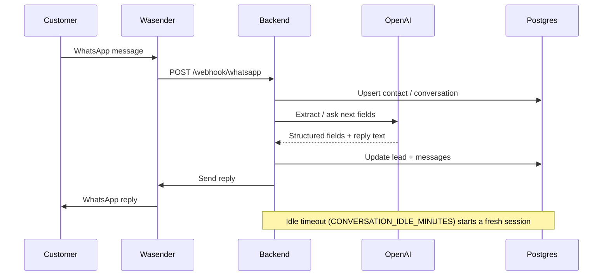
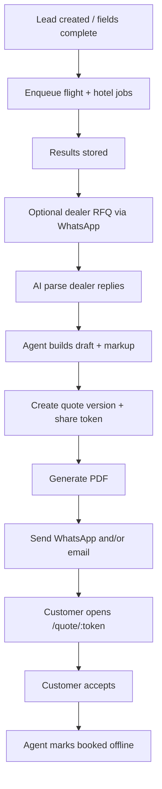
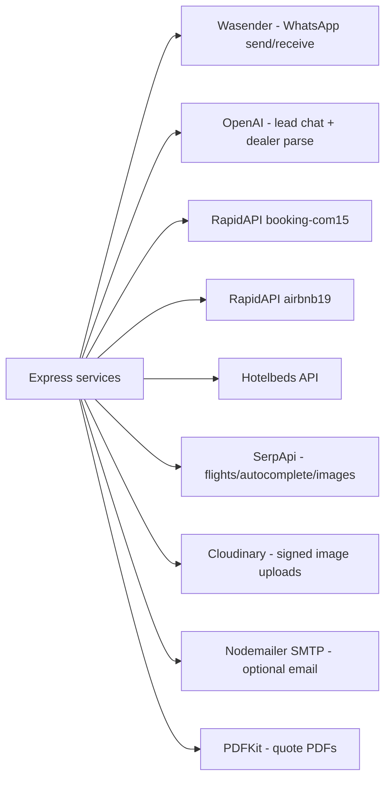

# Horizon Travel — System Architecture

**Product:** Horizon Travel CRM  
**Type:** Internal travel-agency quoting platform (WhatsApp-first)  
**Related docs:** `IMPLEMENTATION-SOW.md` (business), `DEPLOY.md` (ops)

---

## 1. High-Level Overview

Horizon Travel is a **split frontend/backend** system:

| Layer | Technology | Hosting |
|-------|------------|---------|
| CRM UI + public quote page | React 19, TypeScript, Vite, Tailwind | **Vercel** |
| REST API + workers | Node.js, Express 5 | **VPS** (Docker) |
| Primary data store | PostgreSQL 16 | VPS Docker volume |
| Job queue / cache | Redis 7 + BullMQ | VPS Docker volume |

Agents use the CRM. Customers use WhatsApp and a public quote link. Dealers are reached over WhatsApp.



---

## 2. Repository Layout

```text
travel/
├── frontend/                 # Vite React SPA
│   ├── src/pages/            # CRM + public quote routes
│   ├── src/components/       # UI, chat, quote, dealers, ops
│   ├── src/lib/              # API clients, lifecycle helpers
│   ├── src/context/          # Auth, search
│   ├── vercel.json           # /api → backend proxy + SPA fallback
│   └── ...
├── backend/
│   ├── createApp.js          # Express app wiring
│   ├── server.js             # Process entry
│   ├── routes/               # HTTP route modules
│   ├── services/             # Business logic + integrations
│   ├── controllers/          # WhatsApp lead intake
│   ├── workers/              # BullMQ consumers (flights, hotels)
│   ├── queues/               # Queue definitions
│   ├── middleware/           # Auth + roles
│   ├── config/               # DB, Redis, API clients
│   ├── db/                   # init.sql + migrations
│   ├── docker-compose.yml    # postgres + redis + backend
│   └── tests/
├── .github/workflows/        # CI + SSH deploy
├── DEPLOY.md
├── IMPLEMENTATION-SOW.md
└── ARCHITECTURE.md           # this file
```

---

## 3. Frontend Architecture

### 3.1 Stack

- **React 19** + **TypeScript**
- **Vite 8** build tooling
- **React Router 7** client routing
- **Tailwind CSS 4** styling
- Auth state via `AuthContext` (JWT access in memory, refresh cookie)

### 3.2 Routes

| Route | Access | Purpose |
|-------|--------|---------|
| `/login`, `/signup` | Public | Staff auth |
| `/inbox`, `/inbox/:threadId` | Auth | WhatsApp inbox |
| `/leads/hotel\|flight\|package` | Auth | Lead lists by type |
| `/leads/:uuid` (via segment pages) | Auth | Lead workspace |
| `/quotes` | Auth | Predefined package templates |
| `/dealers` | Auth | Dealer directory |
| `/contacts` | Auth | Customer contacts |
| `/settings` | Auth | Account, tools, ops |
| `/quote/:token` | Public | Customer quote view / accept / PDF |

### 3.3 Same-origin API pattern

Production frontend uses Vercel rewrites so the browser calls **`/api/*` on the Vercel origin**, which proxies to the VPS API. This keeps refresh cookies first-party-friendly.

```text
Browser → https://app.vercel.app/api/...
       → Vercel rewrite → https://api.dimyon.ai/travel/api/...
```

Locally, Vite proxies `/api` → `http://localhost:3000`.

---

## 4. Backend Architecture

### 4.1 Process model

A single Node process can run:

- HTTP API (Express)
- BullMQ **flight quote** worker
- BullMQ **hotel quote** worker

Controlled by `APP_MODE` (default: all in one container for the VPS compose stack).

### 4.2 Request pipeline

```text
HTTP request
  → CORS + JSON + cookies
  → request-id / access logging
  → route module
      → requireAuth / requireRole (when protected)
      → service layer
          → PostgreSQL / Redis / external APIs
  → JSON | PDF | file response
```

### 4.3 Route map

| Mount | Auth | Responsibility |
|-------|------|----------------|
| `GET /` | Public | Health / route index |
| `/webhook/whatsapp` | Webhook secret | Inbound WhatsApp |
| `/api/auth/*` | Mixed | Login, signup, refresh, logout, me |
| `/api/leads/*` | Auth | Leads CRUD, segments, import, simulate |
| `/api/flights/*` | Auth | Flight quotes, airports |
| `/api/hotels/*` | Auth | Hotel quotes, destination suggest |
| `/api/inbox/*` | Auth | Threads + send |
| `/api/dealers/*` | Auth | Dealer directory |
| `/api/dealer-requests/*` | Auth | RFQs + responses |
| `/api/quote-draft*` | Auth | Draft build / pricing |
| `/api/quote-versions/*` | Auth | Versioning, send, PDF |
| `/api/q/:token` | Public | Shared quote fetch / accept / PDF |
| `/api/predefined-quotes` | Auth | Package templates |
| `/api/images/*` | Auth | Image search |
| `/api/uploads/cloudinary-sign` | Auth | Signed uploads |
| `/api/ops/*` | Admin | Failed jobs / deliveries |
| `/api/audit` | Auth | Audit events |

### 4.4 Auth model



- Roles: `admin` | `agent`
- Middleware: `requireAuth`, `requireRole`
- Cookie flags: `COOKIE_SECURE`, `COOKIE_SAME_SITE`, `REFRESH_COOKIE_PATH`

---

## 5. Data Architecture

### 5.1 PostgreSQL

Source of truth for:

- Staff accounts (admins)
- Contacts, dealers
- Leads + lifecycle status
- Messages / inbox threads
- Dealer RFQs and responses
- Flight/hotel quote caches (job results)
- Quote drafts, versions, share tokens, acceptances
- Predefined packages
- Audit / delivery / ops records

Schema bootstrap: `backend/db/init.sql` (+ `migrate.js` for updates).

### 5.2 Redis + BullMQ

Two queues:

| Queue | Worker | Job purpose |
|-------|--------|-------------|
| Flight quotes | `workers/quoteWorker.js` | Search flights for a lead |
| Hotel quotes | `workers/hotelQuoteWorker.js` | Search hotels/stays for a lead |

API enqueues work; workers call external travel APIs and persist results.



---

## 6. Core Domain Flows

### 6.1 WhatsApp lead intake



### 6.2 Auto-sourcing → quote → send → accept



### 6.3 Flight provider policy

`FLIGHTS_PROVIDER`:

| Value | Behavior |
|-------|----------|
| `booking` | RapidAPI Booking.com only |
| `google` | SerpApi Google Flights only |
| `auto` | Booking.com first; Google Flights fallback if `SERPAPI_KEY` set |

### 6.4 Hotel multi-source

Hotel worker/services combine:

- Hotelbeds availability/rates
- Booking.com hotels (RapidAPI)
- Airbnb stays (RapidAPI)

Results are normalized for comparison in the CRM.

---

## 7. External Integrations



| Integration | Config prefix | Used by |
|-------------|---------------|---------|
| Wasender | `WASENDER_*` | Webhook, inbox send, quote PDF delivery, dealer RFQ |
| OpenAI | `OPENAI_*` | `openaiLead`, dealer ranking/parsing |
| Booking.com | `RAPIDAPI_*` | Flights + hotels |
| Airbnb | `RAPIDAPI_AIRBNB_*` | Stay alternatives |
| Hotelbeds | `HOTELBEDS_*` | Hotel rates |
| SerpApi | `SERPAPI_*` | Google Flights, suggest, images |
| Cloudinary | `CLOUDINARY_*` | Template/quote images |
| SMTP | `SMTP_*` | Email quote delivery |

Integrations are **env-gated**: features degrade gracefully when keys are missing.

---

## 8. Deployment Architecture

### 8.1 Production topology

```text
                    Internet
                        |
          +-------------+-------------+
          |                           |
   Vercel (frontend)           VPS (Docker Compose)
   - static SPA                - postgres:16
   - /api rewrite              - redis:7
          |                    - backend:3000
          +-------- HTTPS -----+
                               |
                     Reverse proxy optional
                     (Caddy/Nginx TLS)
                               |
                     /webhook/whatsapp (Wasender)
```

### 8.2 Environments

| Env | Frontend | Backend | DB/Redis |
|-----|----------|---------|----------|
| Local | `vite` `:5173` proxy `/api` | `npm run dev` `:3000` | `docker-compose.dev.yml` ports 55432 / 56379 |
| Production | Vercel | Docker Compose on VPS | Compose internal network |
| Optional | — | Replit | Managed DB + Redis |

### 8.3 CI/CD

- **CI** (GitHub Actions): lint/build on push/PR
- **Deploy**: SSH deploy of backend when `main` changes under `backend/**`
- Frontend typically ships via Vercel Git integration

### 8.4 Key production env vars

- `FRONTEND_URL` — public CRM URL for quote links
- `BACKEND_URL` — public API URL for WhatsApp PDF attachments
- `CORS_ORIGINS` — allowed browser origins
- `JWT_ACCESS_SECRET` / `JWT_REFRESH_SECRET`
- Cookie settings for cross-site vs same-origin proxy
- All third-party API keys (see `.env.example`)

---

## 9. Security Architecture

| Concern | Approach |
|---------|----------|
| Staff auth | bcrypt passwords, short-lived access JWT, HttpOnly refresh cookie |
| Authorization | Role checks (`admin` / `agent`) on sensitive routes |
| WhatsApp webhook | Shared secret verification (`WASENDER_WEBHOOK_SECRET`) |
| Public quotes | Unpredictable share token (`/quote/:token`, `/api/q/:token`) |
| CORS | Explicit origin allowlist in production |
| Uploads | Cloudinary signed uploads (no raw secrets in browser) |
| Signup | Public endpoint — **restrict at network layer** in production |
| Logging | Structured JSON logs with `request_id`, no secrets in client |

---

## 10. Observability & Ops

- HTTP access logs with duration, status, admin id/role
- BullMQ job failures surfaced in **Ops** panel (`/api/ops`)
- Delivery failures for WhatsApp/email tracked for admin review
- Audit service records meaningful domain actions
- Container healthchecks for Postgres, Redis, and backend

---

## 11. Design Principles

1. **Agency CRM, not consumer OTA** — search & quote; booking is offline status
2. **WhatsApp as primary channel** — intake, dealer RFQ, quote delivery
3. **Async sourcing** — heavy travel API calls run in BullMQ workers
4. **Multi-source comparison** — normalize hotels/flights for agent decisions
5. **Server-side pricing** — markup/rounding in `pricingEngine`, not only in UI
6. **Versioned quotes** — immutable snapshots + share tokens for customers
7. **Optional integrations** — product runs without every key; live power needs them

---

## 12. Component → Responsibility Map

| Backend module area | Responsibility |
|---------------------|----------------|
| `controllers/whatsappLead.js` | Conversation state machine for intake |
| `services/openaiLead.js` | AI field collection |
| `services/flightSearch.js` / `flights.js` / `googleFlights.js` | Flight providers |
| `services/hotelQuotes.js` / `bookingHotels.js` / `airbnbHotels.js` / `hotels.js` | Hotel providers |
| `services/dealerRequests.js` / `dealerRank.js` | RFQ + reply ranking |
| `services/quoteDrafts.js` / `pricingEngine.js` | Draft build + pricing |
| `services/quoteVersions.js` / `quotationPdf.js` | Versions + PDF |
| `services/quoteDelivery.js` | WhatsApp/email send |
| `services/inbox.js` / `chatSend.js` / `wasender.js` | Messaging layer |
| `services/packageOffer.js` / `predefinedQuotes.js` | Template packages |
| `workers/*` + `queues/*` | Background quote jobs |

---

## 13. Out-of-Architecture (Intentionally Absent)

These are **not** part of the current architecture:

- Payment gateway / PCI checkout
- Supplier booking confirmation APIs
- Customer accounts / mobile app
- Multi-tenant SaaS isolation
- Real-time WebSocket inbox (current model is request/response + webhook-driven updates)

---

## 14. Quick Reference Diagram (All Layers)

```text
┌─────────────────────────────────────────────────────────────┐
│ Presentation                                                │
│  React CRM (auth)  │  Public Quote Page  │  WhatsApp UX     │
└───────────────┬────────────────────┬───────────────┬────────┘
                │ /api               │ /api/q/:token │ webhook
┌───────────────▼────────────────────▼───────────────▼────────┐
│ Application (Express)                                       │
│  Auth │ Leads │ Inbox │ Dealers │ Quotes │ Ops │ Webhook    │
└───────┬───────────────────┬───────────────────┬─────────────┘
        │                   │                   │
┌───────▼───────┐   ┌───────▼───────┐   ┌───────▼────────────┐
│ PostgreSQL    │   │ Redis/BullMQ  │   │ External APIs      │
│ domain data   │   │ async jobs    │   │ WA/AI/OTA/SMTP/... │
└───────────────┘   └───────────────┘   └────────────────────┘
```

---

*For business-facing language, see `IMPLEMENTATION-SOW.md`. For deploy steps and env setup, see `DEPLOY.md`.*
